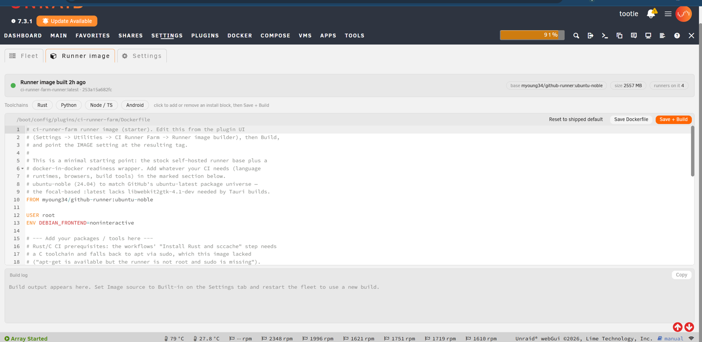
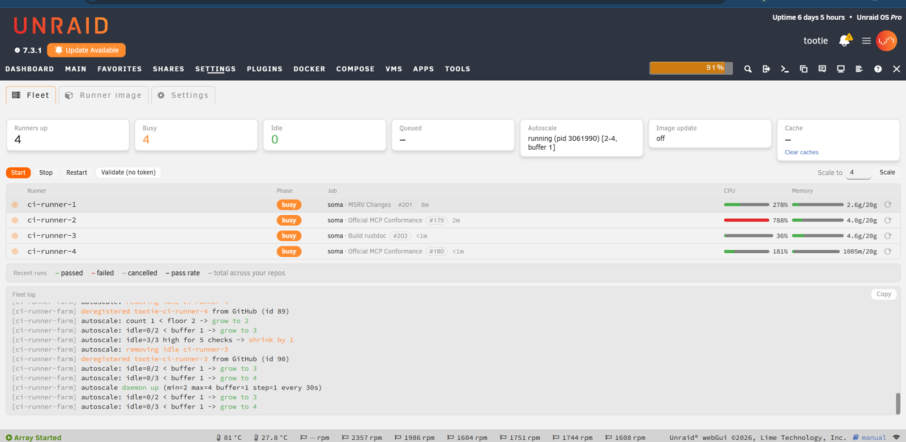

# CI Runner Farm for Unraid

Turn an Unraid server into a resource-capped fleet of self-hosted runners for
**GitHub Actions or GitLab CI/CD**. The farm keeps package and image caches warm,
supports Docker-in-Docker, and can scale several single-job runner slots without
requiring a VM.

GitHub remains the default provider, so an existing installation upgrades
without changing its runner behavior. A farm runs one provider at a time;
switching provider drains and recreates the managed slots with the selected
provider's credentials and runtime.

## What you get

| Capability | What it means |
| --- | --- |
| Concurrent runner slots | Each slot accepts one job at a time and can have CPU and memory limits, keeping CI from starving the rest of the host. |
| GitHub and GitLab providers | Keep the existing GitHub Actions integration or select GitLab.com/self-managed GitLab. |
| Warm shared caches | Reuse npm, yarn, pnpm, Playwright, Cargo, sccache, or custom cache directories across jobs. |
| User-share mounts | Expose selected Unraid user-share directories to trusted GitHub Actions or GitLab CI jobs with read-only or read-write access. |
| Slot-scoped Docker-in-Docker | Give each runner slot a private privileged Docker daemon without exposing Unraid's existing Docker socket by default; privileged DinD is still capable of host compromise. |
| Bring your own job image | Pull a remote image or edit and build a provider-specific starter image in the plugin. |
| Named runner pools | Route jobs to purpose-built pools with independent fixed capacity, labels/tags, CPU, memory, and images. |
| Fleet controls and telemetry | Validate, start, stop, scale, recycle, and inspect runner/job state from the Unraid webGUI. |
| Job-weight recommendations | Show explainable live and historical weights (light, standard, or heavy), a suggested pool, and capacity/routing warnings. Advisory only; it never changes labels, capacity, or workflow routing. |
| Optional autoscaling | Keep a warm idle buffer between configured minimum and maximum runner counts. |

## Architecture

GitHub mode preserves the original container model: each `ci-runner-N`
container is a GitHub Actions runner based on the configured runner image. The
host keeps the GitHub PAT and gives containers only short-lived registration
tokens.

GitLab mode uses the official
[`gitlab/gitlab-runner`](https://docs.gitlab.com/runner/install/docker/) image;
it does not modify or fork GitLab Runner itself. Each slot contains:

- `ci-runner-N`, a persistent GitLab Runner manager with `concurrent = 1`, a
  per-runner `limit = 1`, and a persisted `config.toml` plus
  `.runner_system_id`;
- `ci-runner-N-dind`, by default, a private privileged Docker daemon shared
  with that manager through a Unix socket; and
- one temporary Docker-executor job container for each accepted pipeline job,
  created from the configured default job image or the job's `.gitlab-ci.yml`
  `image:` override.

DinD slots use an explicit private cgroup v2 namespace. The shipped GitHub
runner image prepares that namespace before its base entrypoint starts dockerd,
so nested Podman can create private cgroups without losing the `pids`
controller. The provider keeps the configured process limits; it does not use
host cgroups or disable cgroup enforcement.

The reusable GitLab `glrt-` token identifies the runner configuration. Each
manager retains its own system ID, so recycling a slot does not create a new
shared runner configuration in GitLab.

## Named pools and per-pool images

Set **Runner layout** to **Named pools** when one host should offer different
runner capabilities, for example a normal build pool and a QA-VM client pool.
Each pool record declares a stable pool ID, routing label, additional labels,
fixed capacity, resource limits, and either the built-in image or a registry
image. Containers are named `ci-runner-<pool>-<index>` and carry the pool as a
provider-neutral ownership label.

GitHub pools require organization scope. Their routing and additional labels
are passed to the GitHub runner directly, and a pool that omits `self-hosted`
registers with only those labels, so a generic `runs-on: self-hosted` job cannot
reach it. Single-layout runners keep GitHub's default labels. GitLab pools
require a separate
runner configuration and modern `glrt-` authentication token per pool; create
that runner in GitLab with tags matching the pool's labels, then save the token
with the pool ID in Settings. This keeps GitLab's server-owned tag routing
authoritative instead of pretending local `config.toml` can change it.

KVM is opt in per GitHub runner pool. Add `kvm` to a pool's labels only when its
jobs need hardware virtualization. The farm then requires group-writable
`/dev/kvm` on the host and passes the device and numeric group to that pool's
containers. A missing device prevents those runners from starting; ordinary
build pools do not receive it. VM workflows require `kvm` in `runs-on`.
A change in device availability or group triggers recycling for the KVM pool.
The built-in runner image adds that group to the non-root `runner` user before
registration. Custom images must honor `KVM_GID` the same way when they use
`RUN_AS_ROOT=false`; Docker's `--group-add` alone does not survive the base
entrypoint's `gosu runner` switch.

The V3 record format is:

```text
v3|id|routing-label|additional-labels|fixed|min|max|idle|cpus|memory|image
```

Records are separated by semicolons. `cpus` and `memory` may be `inherit`;
`image` may be `builtin` or a full registry reference. With autoscaling off, each
pool runs exactly `fixed` runners. With `AUTOSCALE="true"`, `fixed` is ignored:
each pool keeps at least `min` runners and grows toward `max` while fewer than
`idle` of its own runners are free (target = busy runners + `idle`). Pool
growth reads only the runners on that host, never the shared provider queue,
so several hosts serving the same organization do not each grow for the same
queued jobs. Pool mode never removes idle runners above `min`; they stay
registered and take the next queued job. Global image auto-update is rejected
in pool mode. Saving pool changes does not interrupt jobs; use Fleet
**Restart** when ready to apply exact membership, images, and limits.

### Job-weight recommendations

The Fleet tab includes a read-only recommendation panel. It classifies active
jobs on a 1–5 scale using the job name, elapsed time, CPU, and memory signals;
maps the result to `light`, `standard`, or `heavy`; and suggests a named pool
when its labels include `size-small`, `size-standard`, or `size-large` (the
short aliases `small`, `standard`, `large`, and `heavy` are also accepted).
Queue pressure produces separate routing or capacity advice. The engine is
deliberately advisory: it does not resize the farm, relabel runners, or change
workflow routing. Completed jobs are aggregated for 90 days into a bounded
history under the plugin configuration directory. The history stores only a
normalized provider/job-family key, counts, duration totals, min/max, and a
coarse histogram; it does not persist URLs, refs, repositories, or branch names.
After three samples, the approximate historical P95 duration can raise a job's
weight and is shown beside the live recommendation.

## Install

### Community Applications

Search for **CI Runner Farm** in
[Community Applications](https://unraid.net/community/apps) and click
**Install**.

### Install by URL

In **Plugins → Install Plugin**, paste:

```text
https://github.com/unraid/ci-runner-farm/releases/latest/download/ci-runner-farm.plg
```

For the moving mainline preview, use the separate CA entry **CI Runner Farm -
Nightly** or paste:

```text
https://github.com/unraid/ci-runner-farm/releases/download/nightly/ci-runner-farm-nightly.plg
```

Nightly is built from each new `main` commit, may contain breaking changes, and
replaces the stable plugin channel on the host. Keep the stable release URL
available for rollback; the two channels are not intended to run side by side.

Each build is also published once as its own prerelease, for example
`v1.14.0-nightly.73`, and is never replaced. To pin a reproducible build, use
that release's `ci-runner-farm-nightly.json` manifest rather than the moving
`nightly` one. The 30 newest build prereleases are kept.

Everything is managed from **Settings → Utilities → CI Runner Farm**. The page
has **Fleet**, **Runner image**, and **Settings** tabs.

## GitHub setup

1. Leave **Active provider** set to **GitHub Actions**.
2. Select repository or organization scope, then configure the owner, target
   repositories, optional runner group, labels, and resource limits.
3. Create and save a classic GitHub Personal Access Token.
4. Configure Docker, caches, job image, and optional autoscaling; then
   **Validate** and **Start** on the Fleet tab.

| Use case | Classic PAT scopes |
| --- | --- |
| Repository runners | `repo` |
| Organization runners | `repo`, `admin:org` |
| Either runner type with a private GHCR image | Add `read:packages` |
| Separate registry token for a private GHCR image | `read:packages` |

The GitHub PAT is stored at
`/boot/config/plugins/ci-runner-farm/token` with mode `0600`; it is not written
to the main config or passed into job containers. Existing GitHub settings,
container names, and the legacy editable `Dockerfile` remain compatible.

### GitHub App authentication (organization scope)

A PAT shares its hourly rate limit with everything else its account runs. An
organization farm can authenticate as a GitHub App instead, which has its own
installation rate limit (15,000 requests an hour on GitHub Enterprise Cloud).

1. Create a GitHub App owned by the organization, with no webhook and these
   permissions:

   | Permission | Access | Used for |
   | --- | --- | --- |
   | Organization: Self-hosted runners | Read and write | Registration tokens, runner listing, removal and labels, runner groups |
   | Repository: Actions | Read | Queued and failed runs, job lists and job logs |
   | Repository: Metadata | Read | Repository visibility checks |

   A private GHCR runner image still needs a registry token. GHCR accepts an
   App installation token as a credential but does not grant it access to
   private organization packages, which only grant access through people,
   teams and repositories' Actions tokens.

2. Install it on the organization with access to every repository the farm
   serves, and generate a private key.
3. Save the key as `/boot/config/plugins/ci-runner-farm/github-app-key.pem`
   with mode `0600`. GitHub's PKCS#1 download and PKCS#8 keys both work.
4. Set **GitHub App ID** and **GitHub App installation ID** on the Settings tab.

With both IDs and the key present, the farm mints a one-hour installation token
into `/var/local/emhttp/ci-runner-farm/github-token` (tmpfs, so the hourly
rotation never writes the flash drive). It reuses the token until 15 minutes
before expiry, and every GitHub request checks that window first, so long
operations never send an expired token. The engine, the Queue Reader and the
native capacity binary all read that minted token. It replaces both the PAT and
the separate Queue Reader token.

App mode fails closed. If no valid installation token can be minted, GitHub
work pauses as it does with no token, and the farm never falls back to the PAT.
At boot the farm retries the mint for up to ten minutes while the network comes
up. Clear both IDs to return to the PAT.

## GitLab setup

### 1. Create the runner in GitLab

Create a project, group, or instance runner using GitLab's
[new runner creation workflow](https://docs.gitlab.com/ci/runners/new_creation_workflow/).
Set its tags, protected status, project/group scope, and whether it may run
untagged jobs in GitLab. Copy the runner authentication token shown after
creation; the token must begin exactly with `glrt-`.

The same token is intentionally reused by the farm's manager slots. Avoid
automatic authentication-token rotation for this shared multi-manager setup:
one manager can rotate first and leave the other persisted managers with the
old token. Rotate manually by stopping the farm, replacing the saved token, and
starting it again. Slot retirement uses the token plus that slot's persisted
system ID to delete only its runner-manager record; it never deletes the shared
runner entity. The plugin rejects `glrtr-` tokens created through the deprecated
registration-token workflow because their unregister semantics can delete that
shared runner. It also rejects instance-prefixed variants: current official
GitLab Runner releases recognize the safe manager-only unregister path only when
the token itself starts with `glrt-`.

### 2. Configure the provider

On the Settings tab:

1. Set **Active provider** to **GitLab CI/CD**.
2. Set **GitLab URL** to `https://gitlab.com` or the HTTPS base URL of a
   self-managed instance.
3. Keep the official manager image or pin a version appropriate for the
   self-managed instance, for example `gitlab/gitlab-runner:v18.5.0`. Explicit
   host-socket mode requires Runner 18.5.0 or newer; Start and Validate reject an
   older or unparseable version because safe host cleanup depends on the exact
   build/helper/service labels fixed in that release. Every mode requires
   Runner 16.0.0 or newer because that release added manager-only unregister
   with a persisted system ID. Older images are rejected rather than risk
   deleting the shared runner entity. Use GitLab 16.0 or newer for a self-managed
   server so its runner-authentication-token and manager-system-ID APIs match
   this lifecycle contract.
4. Save the required `glrt-` runner token.
5. Set the graceful manager shutdown timeout. The default is 7200 seconds.
6. Optionally enter monitored project paths and save a separate access token
   with `read_api`. A project access token covers only its project; for several
   monitored projects use a group token scoped to their common group or a
   dedicated PAT that can read every listed project.
7. Configure resource limits, caches, the default job image, Docker mode, and
   optional image/service execution policy; save, **Validate**, and **Start**.

The runner token is stored separately as
`/boot/config/plugins/ci-runner-farm/gitlab-runner-token`. The optional API
token is stored as `gitlab-api-token`. Core job execution needs only the runner
token; the API token is used exclusively for advisory queue and recent-job
telemetry. GitLab Runner also requires the reusable runner token in each
mode-`0600` per-slot `gitlab-runners/ci-runner-N/config.toml`. Token validation
uses a mode-`0600` `gitlab-token-probe/config.toml`: GitLab verification creates
a temporary manager row, so the plugin immediately unregisters it and retains
that file only when exact cleanup must be retried. After a manager is
successfully unregistered and all of its local containers are removed, ordinary
Stop, scale-down, recycle, and provider switching scrub that slot's TOML, Docker
auth, CA snapshot, and unregister marker while preserving `.runner_system_id`.
Any failed retirement preserves the complete material needed for a safe retry.
Clearing the runner token applies the same rule across the active fleet. Stop,
Restart, manager replacement, and active-token removal send `SIGQUIT`, stop
accepting new jobs, and wait up to
`GITLAB_SHUTDOWN_TIMEOUT` for an in-flight job to finish before Docker forces the
manager to stop. The Unraid `stopping_docker` hook quiesces all GitLab managers
in parallel before Docker stops their DinD sidecars, preserving the same graceful
behavior for array stops and Docker-service restarts. The plugin registers no
diagnostics collector for the
bootstrap/API/registry token files, per-slot/probe `config.toml` files, or Docker auth
files. Current Unraid system diagnostics list the plugin configuration directory
but do not copy those file contents. Do not add those paths to a support bundle
or attach them manually; they contain live credentials even though their modes
are restricted.

If GitLab is permanently unreachable or the saved manager token has been
revoked, normal Stop/Recycle intentionally fails closed and preserves the local
manager identity for retry. The Fleet row's warning action provides a separately
confirmed **force local forget** escape hatch: it interrupts that slot, deletes
its local manager/sidecar/token-bearing config and slot Docker/cache roots
without contacting GitLab, and
leaves any offline remote manager record for you to remove in GitLab manually.

### Self-managed GitLab and custom CAs

Use the complete HTTPS base URL, including a non-default port if required. If
the instance's certificate chain is not already trusted, upload its PEM CA
chain in the GitLab credential band. It is stored as
`/boot/config/plugins/ci-runner-farm/gitlab-ca.crt`. Each manager snapshots the
CA used to create it alongside that slot's `config.toml`, so a CA rotation does
not prevent the old manager identity from unregistering. The manager uses its
snapshot for the GitLab API, and the Docker executor mounts it at the official
`/etc/gitlab-runner/certs/ca.crt` helper path so clone, artifact, and cache
helpers trust it. Runner also exposes the GitLab chain to jobs through
`CI_SERVER_TLS_CA_FILE`, but an arbitrary job image does not automatically add
it to that image's system trust store. Job scripts that call the self-managed
service directly must use that file (for example, `curl --cacert
"$CI_SERVER_TLS_CA_FILE" ...`) or install it using the image's own CA tooling.

In DinD mode the uploaded CA is also installed for the exact authority in
**Registry server**, allowing that per-slot daemon to pull from a registry using
the same private CA. GitLab registry endpoints must use HTTPS (the scheme may be
omitted); plain HTTP is rejected so credentials are never sent to an insecure
registry. GitLab keeps the configured registry credentials available
to each manager even when its default job image is built locally, so an
`image:` or `services:` override can authenticate to that one registry. The
strict-network exception for the configured authority follows the same rule.
This does not discover other registry hostnames from job configuration. If the
GitLab registry uses a different hostname or CA, configure that authority and
chain explicitly. Host-socket mode cannot modify Unraid's Docker trust store;
install the registry CA on the host and restart its Docker service before using
that mode. The built-in shared Docker Hub mirror is local HTTP and is explicitly
scoped as an insecure registry inside each DinD daemon; the uploaded CA is
unrelated to it.

Strict network isolation normally blocks the host and LAN. GitLab mode adds a
narrow exception for the configured GitLab endpoint so a self-managed instance
remains reachable; do not use a broad LAN allow rule. Configure private job
image registries explicitly rather than weakening the runner network.

Each private DinD daemon also allocates per-build job and service networks from
Docker's default address pools. If a self-managed GitLab or registry lives in a
private CIDR that overlaps those pools (commonly `172.16.0.0/12`), an inner
Docker route can shadow the real endpoint even though the farm firewall allows
it. Keep CI/registry endpoints on non-overlapping subnets, or configure suitable
Docker default address pools before relying on that topology.

### Queue telemetry limitation

GitLab does not expose one public API endpoint containing every pending job
eligible for a particular runner. With a `read_api` token, the plugin can count
pending/recent jobs only for **Monitored projects** that the token can read.
That number is advisory: it can omit other eligible projects and jobs excluded
by tags or protection rules. Runner execution and busy/idle scaling do not rely
on it.

## Job images

The Runner image tab maintains provider-specific editable files on flash:

- `Dockerfile.github` for the GitHub runner container;
- `Dockerfile.gitlab` for GitLab Docker-executor job containers; and
- legacy `Dockerfile`, used as the GitHub fallback so existing customized
  installs keep working.

The packaged starter files are `default.github.Dockerfile` and
`default.gitlab.Dockerfile`; the original `default.Dockerfile` remains
byte-identical to the GitHub default for compatibility. The GitLab starter is a
general Ubuntu job image with common build tools and a Docker client. It is
deliberately not the GitLab Runner manager image. A GitLab job may override the
default with:

```yaml
build:
  image: node:24
  script:
    - npm ci
    - npm test
```

GitHub-only image controls such as `EPHEMERAL`, `RUN_AS_ROOT`, and the workspace
tmpfs do not change GitLab Docker-executor semantics. GitLab jobs are **always
ephemeral at the job-container layer**: the manager and configured caches
persist, but every accepted job receives a fresh Docker container.

### GitLab execution policy

Pipeline write access implies job-image selection and code execution on this
host. The GitLab settings therefore expose the Docker executor's
`allowed_images`, `allowed_services`, `pull_policy`, and `shm_size` controls:

- `GITLAB_ALLOWED_IMAGES` and `GITLAB_ALLOWED_SERVICES` are space-separated
  wildcard patterns. Empty values deliberately preserve the upgrade-compatible
  GitLab Runner default of allowing every image; configure explicit trusted
  registries or image families to narrow that exposure.
- `GITLAB_PULL_POLICY=auto` preserves existing behavior (`if-not-present` for
  the locally built image, `always` for a remote default). An explicit
  `always` or `if-not-present` value is also written as
  `allowed_pull_policies`, so jobs cannot select a different pull policy.
  Explicit `always` requires a remote default image; it is rejected for the
  locally built tag because Runner would try to pull a tag with no registry.
  Runner's `never` policy is rejected because a fresh per-slot daemon cannot
  obtain the helper and service images required to execute its first job.
- `GITLAB_SHM_SIZE` is an integer byte count for Docker-executor containers.
  The default `0` preserves Docker's default; browser/test workloads commonly
  need a larger value such as `1073741824` (1 GiB).

These controls follow GitLab Runner's
[Docker executor configuration](https://docs.gitlab.com/runner/configuration/advanced-configuration/#the-runnersdocker-section).
They govern images and services admitted by GitLab Runner; they are useful
guardrails against accidental or declarative `.gitlab-ci.yml` overrides, not a
security boundary. Every job, helper, and service container receives the
selected Docker socket, so its code can invoke the Docker API directly to
pull/run an otherwise disallowed image;
against privileged DinD it can also request privileged nested containers. Route
only trusted code to this farm even when allowlists are configured.
Maximum job duration is server-owned runner metadata rather than a local
`config.toml` key; set it on the runner in GitLab or with the
[Runners API](https://docs.gitlab.com/ci/runners/configure_runners/#set-the-maximum-job-timeout).



## Cache scope and concurrency

GitLab's native `/cache` bind is deliberately **per slot**
(`gitlab-cache/ci-runner-N`), so managers do not race on the same Runner cache
files; the tradeoff is that a cache warmed on one slot is not automatically
available on another. The configurable `CACHE_MOUNTS` directories are different:
they are shared across every slot for package-manager reuse. Use them only for
cache formats whose tools support concurrent writers, or assign disjoint
directories yourself. The plugin does not currently emit GitLab's distributed
S3 cache configuration, so an external MinIO/S3 backend is not yet a supported
configuration key.

For GitHub runners, the `pnpm-store:<container-path>` cache entry also sets
`PNPM_CONFIG_STORE_DIR` (pnpm 11) and `npm_config_store_dir` (pnpm 10) to that
exact bind destination. This prevents pnpm from selecting `/_work/.pnpm-store`
when the workspace is on tmpfs. Custom destinations work the same way; duplicate,
relative, noncanonical, read-only, or workspace-root destinations are rejected.
Without a `pnpm-store` entry, pnpm keeps its normal configuration. The existing
configuration-drift lifecycle drains and replaces runners that need the new
store environment after an upgrade.

A `blob-cache:<container-path>` entry similarly sets `CI_BLOB_CACHE_DIR` to its
bind destination for GitHub runners. Jobs use it to share content-addressed
downloads with later jobs on the same host. Every job on the host can write it,
so a client must verify each object's size and digest on its own copy before
use, and must keep the directory within its own byte budget. The destination must be
canonical and outside `/_work`. Adding the entry, or upgrading a farm that
already has it, drains slots onto the variable through the normal lifecycle.

An `ms-playwright:<container-path>` entry sets `PLAYWRIGHT_SKIP_BROWSER_GC=1`
for GitHub runners and GitLab jobs. Each `playwright install` normally deletes
every browser build that no installation in its own container uses. Workspaces
are per container, so without the variable a job pinned to one Playwright
version deletes the browser that a job on another slot is running. With it,
each Playwright version keeps its own build directory. The directory grows by
one build per Playwright upgrade, and `cache-clear-pkg` reclaims it while the
fleet is idle. Adding the entry, or upgrading a farm that already has it,
replaces slots through the normal lifecycle.

Packages copy from the pool-backed store into a workspace on another filesystem
because hard links cannot cross filesystems. This keeps the package store out of
workspace RAM; project `node_modules` and Actions archive downloads still consume
workspace space. Shared stores are for mutually trusted jobs. A raw Actions cache
archive restore is not pnpm's coordinated install protocol; do not restore such
an archive into a store being used by another job.

## User-share mounts

Set `USER_SHARE_MOUNTS` to a space-separated list of
`host-path:container-path:ro|rw` entries. For example:

```text
/mnt/user/ci-runner/shared:/mnt/shared:rw
```

Each source must be an existing canonical directory below
`/mnt/user/<share>/`; the destination must be a safe path below `/mnt` inside
the job container. `ro` makes the mount read-only; `rw` permits writes. The
setting works with GitHub Actions runner containers and GitLab Docker-executor
jobs. It is separate from `CACHE_MOUNTS`, which creates cache directories under
`CACHE_ROOT`. Overlapping sources or destinations are rejected.

Every job routed to a runner with these mounts can access the configured files.
Restrict runner routing to trusted repositories and use a dedicated subdirectory
for each purpose. Keep `CACHE_ROOT`, Docker data, and workspace storage on a
pool; Docker-in-Docker overlay storage does not work on the FUSE user-share
filesystem. Another trusted service can mount the same host path read-only to
consume files without copying them through the CI artifact service.

## Docker and security

Self-hosted runners execute repository-controlled code on your hardware. Use
privileged or socket-mounted runners only for trusted private projects.

- **DinD is slot-scoped, not host-secure.** Each GitLab slot gets a private
  privileged daemon, and `concurrent = 1` limits its normal cross-job blast
  radius to that slot. The daemon creates the job, helper, and service
  containers, and its socket is mounted into job, helper, and service containers;
  any of them can therefore inspect or remove those siblings, pull/run images that
  bypass Runner's image/service allowlists, and request privileged containers
  inside the nested daemon. More importantly,
  the DinD sidecar itself is privileged and must be treated as capable of host
  compromise. It avoids handing jobs Unraid's existing Docker control socket,
  but it is not a security boundary against the NAS. GitLab validation rejects
  configurations with neither DinD nor host-socket sharing because the Docker
  executor would have no endpoint.
- **Host socket sharing is root-equivalent host access.** Enable it only as an
  explicit alternative for trusted jobs. A job that controls
  `/var/run/docker.sock` can control Unraid's containers and host filesystem.
  GitLab host-socket mode requires `NETWORK_ISOLATION=off`: per-build networks
  are created by Unraid's daemon and cannot be confined by attaching only the
  manager to the farm's dedicated bridge.
- **Public/fork pipelines are dangerous.** Do not route untrusted merge-request
  or pull-request code to privileged DinD or host-socket runners. Enforce
  protected runners, tags, runner groups, and private project scope at the CI
  provider.
- **Credentials are separated.** Runner-management credentials live in
  mode-`0600` host files, not `ci-runner-farm.cfg`. Registry credentials use the
  separate `registry-token` file. Clearing it unlinks every per-slot auth file
  and the plugin-owned tmpfs Docker client config immediately; the plugin never
  logs registry credentials into root's global Docker config. Managers mount the
  containing per-slot directory and observe removal. An image pull that already
  authenticated may still finish.
- **Ephemeral runners start with a clean workspace.** With `EPHEMERAL=true`
  and no workspace tmpfs, each new runner container gets an empty `/_work`
  bind directory. Checkouts with their Git metadata, build output, and actions
  downloaded by earlier jobs on that slot do not carry over. The old directory
  is renamed aside on the same filesystem and deleted in the background, which
  also reclaims the workspace disk of each slot as it is recreated. The cost is
  a fresh fetch on every checkout: about 10 seconds more for a full-history
  (`fetch-depth: 0`) checkout of a large repository, and a few seconds for a
  shallow one. This covers the workspace only. Shared `CACHE_MOUNTS` and each
  slot's Docker-in-Docker data are kept and still carry state between jobs, so
  route only mutually trusted repositories to one farm. A slot directory that
  is a separate mount is refused rather than emptied. Persistent runners
  (`EPHEMERAL=false`) keep their workspace across jobs by design.
- **Network isolation matters.** `isolate` separates runner containers from
  other Unraid containers. `strict` also blocks the Unraid host and LAN, apart
  from narrowly configured service endpoints.

GitHub runner containers resolve `runner-farm.host` to the management address
of the Unraid host that launched them. Use this stable alias for a service that
is deliberately colocated with a runner pool. `host.docker.internal` remains
the Docker bridge gateway for local Docker services. In `strict` mode, only TCP
port 22 on the exact `runner-farm.host` address is allowed for the colocated QA
VM MCP transport; other host and LAN access remains blocked.

See [GitHub's self-hosted runner security guidance](https://docs.github.com/en/actions/hosting-your-own-runners/managing-self-hosted-runners/about-self-hosted-runners#self-hosted-runner-security)
and [GitLab's self-managed runner security guidance](https://docs.gitlab.com/runner/security/).

### Runner DNS

On `isolate` and `strict` networks, runners resolve names through Docker's
embedded DNS. It forwards each lookup to the host's resolvers, tries each one
once for 4 seconds, and then returns `SERVFAIL`. A host with a single resolver,
such as one handed out by DHCP, therefore turns one lost UDP packet into a
failed lookup (`Could not resolve host`, `EAI_AGAIN`).

`RUNNER_DNS="1.1.1.1 8.8.8.8"` (GitHub only, empty by default) gives each runner
up to three IPv4 resolvers, tried in order. Docker then fails over to the next
resolver instead. The setting lives only in `ci-runner-farm.cfg`. Empty keeps
the host's resolvers and the existing runner fingerprint; setting or changing
the list replaces idle runners through the normal drain. Start fails on an
invalid list: loopback, unspecified and multicast addresses are rejected, and
`strict` also rejects private and CGNAT addresses because its egress rules
block them. Host DNS itself is unchanged.

## Fleet and autoscaling

The Fleet tab shows provider-neutral runner, project, job, ref, CPU, and memory
state while retaining GitHub run/PR links for compatibility. Runner-manager logs
are available from each slot; job links open in the provider UI. The autoscaler
maintains the configured minimum, maximum, and warm-idle buffer and drains busy
slots before recycling or switching provider. Autoscaling is off by default and
must be explicitly enabled for GitLab; when enabled, it uses observed manager
metrics and job containers, never the incomplete advisory project queue. A
provider switch is an idle-drained rolling transition: a busy old-provider slot
finishes first, its old adapter deregisters it, and only then is that slot
recreated for the new provider.
The Fleet tab may therefore briefly show both providers during the transition;
ordinary steady state still has one active provider.

Alongside reaping dead or deregistered slots, the autoscale tick also
self-heals build-poisoned GitHub DinD slots. If a slot's nested Docker daemon
crashes mid-build, its persistent buildkit store can be left with dangling
lease metadata or missing snapshot parents: every later build on that slot
fails while the runner itself stays healthy and keeps accepting jobs. The farm
detects the supported BuildKit corruption signatures from the failed job
logs on GitHub (the only place the error is visible), then — only while the
slot is idle, and at most once per slot per hour — stops the container,
clears just the `buildkit/` subdirectory of its Docker root (warm image and
layer caches survive), and starts the same container again. Events appear in
the autoscale log.

Every running fleet also has a provider-neutral lifecycle watchdog. For idle
GitHub DinD slots, it checks the runner's private Docker daemon for leftover job,
helper, or service containers and removes those containers while preserving
images, volumes, and layer caches. It also checks outer-runner PID pressure.
Two consecutive failed cleanup or pressure checks trigger a full slot recycle.
The watchdog runs independently of autoscaling, so fixed-size fleets receive
the same protection. GitLab keeps its manager-owned lifecycle path and exposes
no candidate to this watchdog.

### CPU pinning

A CPU limit (`--cpus`) caps a runner's CPU time, but tools that size their
parallelism from the CPU affinity mask (`nproc`, `make -j`, test and bundler
worker pools) still see every host CPU, start that many workers, and spend
most scheduling periods throttled. `CPU_PINNING="true"` (off by default,
GitHub only) also gives each runner with a whole-number CPU limit a cpuset of
that many host CPUs, so the runner and containers started by its nested Docker
daemon see the right CPU count. The CPU limit and capacity accounting are
unchanged.

Placement reads the host topology from sysfs. It prefers whole physical cores
spread across L3 cache domains, then their SMT sibling threads, and picks the
CPUs least used by the farm's other live containers; overcommitted runners
share the least-loaded CPUs. "Least used" is measured: every 30 seconds the
farm samples each managed container's cgroup v2 CPU usage (under
`/sys/fs/cgroup/docker/<id>` or `system.slice/docker-<id>.scope`). A candidate
block scores the cores its occupants used recently, plus half the usage on its
SMT sibling CPUs, which share the same physical cores. The score is rounded to
quarter cores, so a block whose total is below about an eighth of a core counts
as idle. A runner started since the last sample counts as fully busy, so a
burst of starts does not pile onto the same idle block. Ties, and placements
without any recent sample (for example on cgroup v1), fall back to counting
the cpusets that overlap each block. Ephemeral runners are placed again after
every job, so busy runners spread out over time without moving running
containers. Runners with a 1-CPU limit land on the least-used single CPU, and
their usage counts against any larger block that contains it. The chosen
cpuset is recorded in the `net.unraid.ci-runner-farm.cpuset` label. A
fractional or missing CPU limit, a limit larger than the host, or unreadable
topology logs a warning and starts that runner unpinned. Turning the setting on or off changes the configuration
fingerprint of pinnable slots, so they are recreated like any other baked
setting; with it off, existing fingerprints are unchanged.

### Growth backpressure

`GROWTH_BACKPRESSURE="true"` (off by default) makes autoscale growth depend on
live host resources. Before the farm starts a runner in a slot above the
minimum (`AUTOSCALE_MIN`, or a pool's `min`), it checks two thresholds: host CPU
busy percent, from `/proc/stat` between autoscale checks, must not be above
`GROWTH_CPU_CEILING` (default `80`), and `MemAvailable` must be at least the
runner's memory limit plus `GROWTH_MEMORY_RESERVE` (default `8g`). With `CPU_PINNING="true"`, it also
checks the CPU block the new runner would be placed on: when that block's
runners used 3 cores or more recently (counting half of the use on its SMT
sibling CPUs, as placement does), the start waits. On a 4-CPU block this is
about 75% use, so a new runner still gets about a core. Placement already picks the
least-used block, so this only withholds growth when every block is that busy.
Runners started since the last usage sample count as fully busy, so growth
can pause for a check or two right after a burst of starts, and only one start
per check passes this test. The check is skipped while no pinned runner has a
usage measurement yet. When the kernel exposes pressure stall
information (`/proc/pressure`), memory pressure (avg10) above 5% "full" or
20% "some" also withholds the start, as a safety net beside `MemAvailable`.
Each start admitted in one check deducts its memory limit, and at most two such starts
are admitted per check, because new runners use no resources until they get a
job. The gate only withholds starts: it never stops, drains, or removes a
running or busy runner, and starts that refill slots up to the minimum are
never checked. An exited ephemeral slot above the minimum stays exited until
the host has headroom again. If the metrics cannot be read, the fleet does not
grow past the minimum. Each change of decision is logged with its numbers in
the autoscale or lifecycle log, and the latest decision appears next to the
autoscale state on the Fleet tab and in `status`. While autoscale is on and
the kernel exposes pressure stall information, the same places also show host
CPU, memory and IO pressure (avg10), whether or not the gate is on. The settings are read on
every check and do not change the configuration fingerprint, so turning them
on or off recreates no runners. Single-layout autoscale also adds the fresh
provider queue depth to its growth target; each host reads the same queue, so
several hosts can grow for the same jobs, and the surplus idle runners are
removed by the normal scale-down: `AUTOSCALE_STEP` idle runners per
`AUTOSCALE_IDLE_GRACE` checks while more than `AUTOSCALE_MIN_IDLE +
AUTOSCALE_STEP` sit idle.

Growth and CPU pinning work together, with one tradeoff. Once the farm's
pinned runners, across all pools, outnumber the host's cpuset blocks (at most
host CPUs divided by the runner's CPU limit), pinned runners share blocks:
placement puts each extra runner on the least-loaded block, so a 32-thread
host with only 4-CPU runners gives the 9th to 16th runners the same eight
blocks, two runners each. Runners that share a block contend
for those CPUs even while other host CPUs are idle, because the cpuset stops
them from using any other CPU. Unpinned runners in the same state would spread
across idle CPUs. The CPU ceiling measures the whole host, so it does not see
one hot block; the block check above does, and withholds growth that would
land on a busy block. Use pinning with growth when tools that size themselves
from `nproc` are the bigger problem. Leave pinning off when a pool is often far
above that block count.



## CLI

```text
include/runner-farm.sh {start|boot-autostart|docker-stopping|stop|restart|scale N|status|status-json|recommendations-json|logs i|validate|build-image|prune-cache|autoscale-*|lifecycle-*|history-daemon}
```

## Development

Fork the repository on GitHub, then keep the canonical project as `upstream`:

```sh
git clone git@github.com:YOUR-ACCOUNT/ci-runner-farm.git
cd ci-runner-farm
git remote add upstream https://github.com/unraid/ci-runner-farm.git
git switch -c feat/gitlab-provider
```

Run all checks in the bundled Linux environment. This is the preferred command
on macOS because the host commonly has Bash 3, BSD tar/realpath, and no PHP CLI:

```sh
./tests/run-linux-checks.sh
```

With compatible Linux tools installed, run `bash tests/check.sh` directly.
Checks cover Bash/PHP syntax, config parity, safe cache paths, the provider and
credential contract, fork release guards, generated XML, and exact package
contents.

Build and deploy to a disposable Unraid development host:

```sh
./build-plg.sh
./deploy.sh root@tower
```

`deploy.sh` uploads the complete runtime into a staging directory, validates
its sentinels and permissions, then performs a rollback-protected replacement
of the development copy.
Stop the fleet before deploying; the script refuses an active fleet/daemon so
long-running processes cannot keep executing an unlinked older engine while
new web actions use the replacement.
The generated `.plg` downloads a version-pinned reproducible `.tgz`; it is not
an inline/base64 package.

### Private artifact services

Private artifact services can use `ARTIFACT_ENDPOINT="https://artifacts.example.com:8333"`
with strict network isolation. The setting accepts one HTTP(S) origin without
credentials or a path. Only its resolved IPv4 addresses and TCP port are allowed;
other host and LAN access stays blocked. The next Start applies the setting.
Operators can run `runner-farm.sh reconcile-network` after saving the
configuration to apply it through the native fleet lock without restarting
runners. The existing additive policy preserves old exceptions while a managed fleet is present;
removed exceptions retire only when the empty-fleet policy is rebuilt. Workflow
credentials and artifact retention remain the artifact service's responsibility.

### Layout

```text
ci-runner-farm.plg                  generated installer metadata
build-plg.sh                        packages src/ into .plg + reproducible .tgz
deploy.sh                           complete-tree atomic dev deployment
tests/check.sh                      Linux/CI check entry point
tests/run-linux-checks.sh           containerized local check entry point
src/usr/local/emhttp/plugins/ci-runner-farm/
  default.Dockerfile                legacy GitHub starter (compatibility)
  default.github.Dockerfile         named GitHub runner starter
  default.gitlab.Dockerfile         GitLab Docker-executor job starter
  default.cfg                       public reference defaults
  include/runner-farm.sh            common lifecycle engine
  include/runner-recommendations.sh live weight and pool-target heuristics
  include/runner-history.sh         bounded durable duration aggregates
  include/providers/                provider adapters
  include/exec.php                  CSRF-guarded web endpoint
```

The release workflows are guarded to `unraid/ci-runner-farm`. They remain inert
in forks even when a fork pushes `main`, tags `v*`, or dispatches them manually.
The fork's CI stays on GitHub; no `.gitlab-ci.yml` is required to add GitLab as a
runtime provider.

## Releases and support

Canonical releases use release-please and GitHub Release assets. Questions and
bug reports: <https://github.com/unraid/ci-runner-farm/issues>

### Runner resources

Farm manages its own runner containers with the configured CPU quotas, CPU
sets, memory limits, images, labels and per-pool counts. GitHub Actions or
GitLab workflows own builds, temporary VMs, output and job artifacts.

Farm does not expose a host-wide resource allocator, allocation SDK, ownership
receipt API or shared memory-admission service. Other host workloads need their
own resource configuration. Named-pool autoscaling grows within each configured
pool maximum using current runner occupancy and its warm-idle target.

The former shared host allocator and its QA bridge have been removed. Existing
`host-capacity.json` or `shared-capacity.*` activation records and enabled
`ELASTIC_POOLS`/`QUEUED_POOLS` settings block new runner starts until the
operator completes the deployment migration. Farm never deletes those records
or treats their removal as proof that another workload stopped. Migrate other
consumers and account for their existing workloads before installing this
breaking release. Running hosts are not migrated by source publication.

### Retired Docker storage

Farm no longer mounts the shared cache. Replacement GitHub runners do not
receive `/mnt/ci-cache` or `CI_SHARED_CACHE`, and Farm ignores a saved
`SHARED_CACHE_ROOT` key. A job that uses that path can fail or lose access to
its shared data. Move affected workflows to another store before you upgrade. A
runner that has the mount keeps it until the normal config-generation
replacement after its current job finishes.

Persistent GitHub DinD runners also receive a synchronous completed-job hook.
The wrapper runs the image’s existing completion hook first and preserves its
exit status. Images can use an absolute `.sh` or `.ps1` hook path.
It removes only unreferenced local Buildx cache volumes whose names end with
that job's exact `-<run-id>-<attempt>0_state` suffix. Stable builder caches,
custom-labeled volumes, other jobs, package caches and referenced volumes stay
intact. The pass has a 30-second limit and makes no GitHub API requests. A
Farm cleanup error is logged without changing the job result. Existing runners
receive the hook through the normal config-generation replacement after their
current job finishes.

Workflows still own reusable cache export and import. Configure Buildx with a
repository/image/platform scope using GitHub Actions or OCI registry caches.
Do not share writable Docker graph directories or BuildKit daemon state between
independent daemons. Exported layer caches do not automatically preserve
`RUN --mount=type=cache` compiler stores. Retain a stable builder with bounded
garbage collection or explicitly persist those stores when the workflow needs
them. Old abandoned run-specific volumes need a separate verified cleanup;
the completed-job hook never guesses ownership of historical data.

Persistent DinD farms can also opt specific reusable Buildx builders into
storage-pressure eviction. Set the engine-only `DOCKER_CACHE_BUILDERS` to a
comma-separated list, for example `project-builder,project-fedora-builder`.
Use only builders whose volumes contain disposable build cache, never artifacts
or other durable data. Up to 32 names are accepted. The list order is the
eviction preference; it is not a last-used timestamp.

After a job completes, the hook checks the Docker store's filesystem against
`DOCKER_CACHE_MIN_FREE_PERCENT` (15% by default). Below that free-space floor,
it can remove at most one listed builder's local, unreferenced state volume.
All container references, including stopped containers, prevent removal.
Labels, driver options, nonlocal volumes, changed daemon identity and unknown
space information preserve the cache. Docker arbitrates the final non-forced
removal. Warm caches stay intact above the floor or when the list is empty.
This runs inside the existing 30-second job cleanup budget and preserves the
original image hook's exit status. Changing the policy uses normal idle runner
configuration replacement; running jobs are not interrupted. This is a
free-space reclamation policy, not a hard per-runner disk quota.

GitHub Docker-in-Docker stores persist between runner jobs. Without cleanup,
completed runners can retain large image and build caches. The lifecycle and
autoscale ticks reclaim completed stores when the dataset has less than 15%
free space. Set the engine-only `DOCKER_CACHE_MIN_FREE_PERCENT` to an integer
from `0` to `100`. Set `0` to disable automatic cleanup.

Cleanup requires an exited or dead managed container, its exact Docker identity,
and the matching Docker data bind. It rejects restart policies, symlink paths,
other container references and nested host mounts. Shared hosts retain their
existing durable prepare/release checks. Running, paused and created containers
remain untouched. Free space is checked after each removal. Normal admission
replenishes the configured runner floor. Unknown disk information or failed
cleanup preserves normal recovery.

Persistent runners can also prune their own Docker state after each job. This
is off by default because it removes state a later job could reuse. Set the
engine-only `DOCKER_JOB_PRUNE="true"` to enable it. Each job then removes
stopped containers, anonymous volumes, dangling images and dangling build
cache. Below the free-space threshold it also removes every unused image and
the checkouts of other repositories. Enabling it replaces idle runners once.

For an explicit cleanup run, use
`include/runner-farm.sh prune-completed-docker --dry-run`, then
`include/runner-farm.sh prune-completed-docker --apply`. Both commands acquire
the fleet lock and inspect current ownership. Coordinate external Docker and
mount operations during maintenance because those writers do not use this lock.

Use `include/runner-farm.sh prune-retired-docker [--dry-run]` for a read-only
snapshot of slot Docker stores without observed references. It inspects all
Docker containers, including stopped and foreign containers, the host Docker
data root and host mount targets. Unavailable reference information fails the
inventory. Symlink paths and unknown directory names are omitted.

This snapshot does not authorize deletion: external Docker clients and host
mount writers do not acquire the native fleet lock. `--apply` is rejected before
that lock is opened, and the command never removes or moves files. Do not use
the output as input to a deletion command. Current job workspaces and warm
package caches are outside this inventory's scope.

These commands do not impose a size limit on active Docker stores. Keep
build headroom when you budget disk space.
